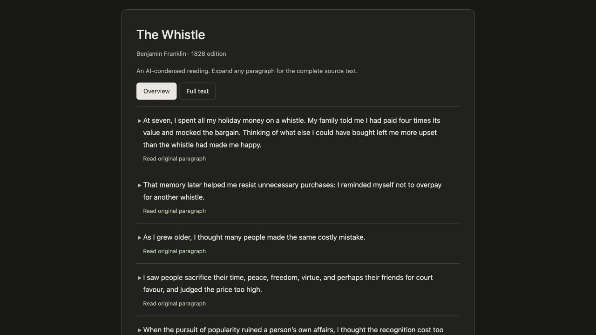
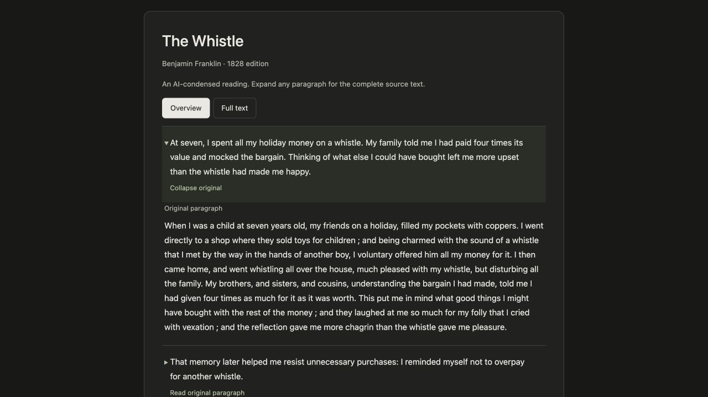

# Quick Read

A Codex skill for reading long texts and complete answers through a concise overview, with the full text available section by section.

The overview is a coherent rewrite of the source's meaning, not a collection of excerpts. It preserves the narrative perspective, main logic, important conditions, and uncertainty. The complete layer retains the original wording and order unless you explicitly request editing or translation.

By default, the overview, headings, and controls use the source language and writing variant. Asking a question in another language does not automatically translate the source. Explicit language requests apply only within the scope you specify.

## Reading experience

- Read the condensed overview with all complete sections initially collapsed.
- Expand any section directly below its overview; several sections can stay open at once.
- Switch to **Full text** to read the complete content without repeated overviews. Switching back restores the sections you previously opened.

Condensing necessarily leaves out detail and original expression; expansion keeps them available. Click-to-expand requires a compatible presentation environment. When disclosure is unavailable, the skill provides corresponding overview and full-text sections in a readable sequence.

## Example: *The Whistle, A True Story*

**[Try the live interactive demo](https://chakcodes.github.io/quick-read/)** in your browser. No installation is needed: expand any paragraph or switch between **Overview** and **Full text**.

This example uses Benjamin Franklin's public-domain short piece from the [1828 edition on Wikisource](https://en.wikisource.org/wiki/Way_to_wealth%2C_or%2C_Poor_Richard%27s_maxims_improved/The_Whistle%2C_A_True_Story). The overviews are AI-written condensed rewrites, not Franklin's own words. The complete layer preserves the wording of this edition, including its historical spellings.

**Default overview**



**One section expanded**



For offline use, download the [standalone HTML demo](examples/the-whistle.html): choose **Download raw file** on its GitHub file page, then open the downloaded file in a browser. GitHub's file view does not execute the HTML. The [example JSON](examples/the-whistle.json) contains both the condensed overviews and the complete text.

## Install

Find Quick Read on [skills.sh](https://skills.sh/chakcodes/quick-read/quick-read).

Use the [Skills CLI](https://skills.sh/docs/cli) with Node.js 22.20 or later. From your project directory, run:

```bash
npx skills add chakcodes/quick-read --skill quick-read -a codex
```

This installs Quick Read for Codex in the current project. Add `-g` for a user-level installation across projects. Omit `-a codex` to choose another supported agent; interactive rendering depends on that agent's presentation capabilities.

Alternatively, clone this repository into your user-level Codex skills directory:

```bash
mkdir -p "$HOME/.agents/skills"
git clone https://github.com/chakcodes/quick-read.git "$HOME/.agents/skills/quick-read"
```

If Quick Read is already installed, use that installation instead of cloning over it or creating a duplicate. Codex discovers installed skills automatically; restart only if the new skill is not discovered. See the official [Build skills guide](https://learn.chatgpt.com/docs/build-skills) for supported skill locations and invocation.

Alternatively, if the Skill Installer is available, ask Codex:

```text
$skill-installer Install the skill from https://github.com/chakcodes/quick-read.
```

## Use

Invoke the skill explicitly with `$quick-read`, or describe the matching reading task and let Codex select it. For example:

**An existing article**

```text
$quick-read Turn the attached article into an overview I can read on its own, with the complete original text expandable by section.
```

**A new technical answer**

```text
$quick-read Explain how HTTP caching works. Show a concise overview first, with the complete explanation available by section.
```

**An explicit language scope**

```text
$quick-read Create a Spanish overview of the attached English article. Keep the complete original text in English.
```

## Optional HTML renderer

The skill includes a Python 3 renderer with no third-party dependencies. Python is only needed when running this optional renderer. It validates and displays prepared content; it does not write overviews or translate text.

From the repository directory, generate a standalone version of the example:

```bash
python3 scripts/render_reader.py examples/the-whistle.json reader.html --standalone
```

Open `reader.html` in a browser. Existing output files are protected; add `--force` when intentionally replacing your own preview. Omit `--standalone` to generate an HTML fragment for a compatible inline renderer.

The included template displays the body as plain text, preserving line breaks, indentation, and code text. It does not parse Markdown, formulas, or HTML. Rich content needs an appropriate renderer or a complete source file that preserves its formatting.

See [SKILL.md](SKILL.md) for the content and language rules, and the [rendering contract](references/rendering.md) for the JSON schema and presentation requirements.
